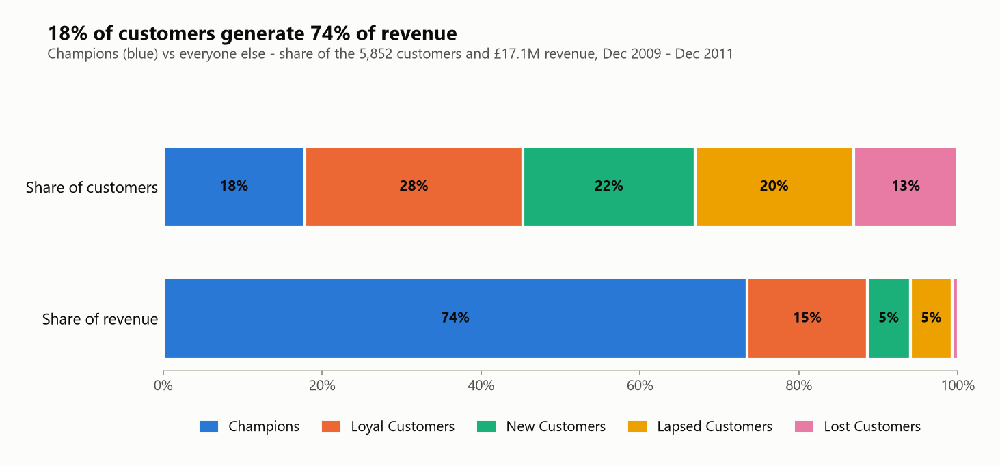
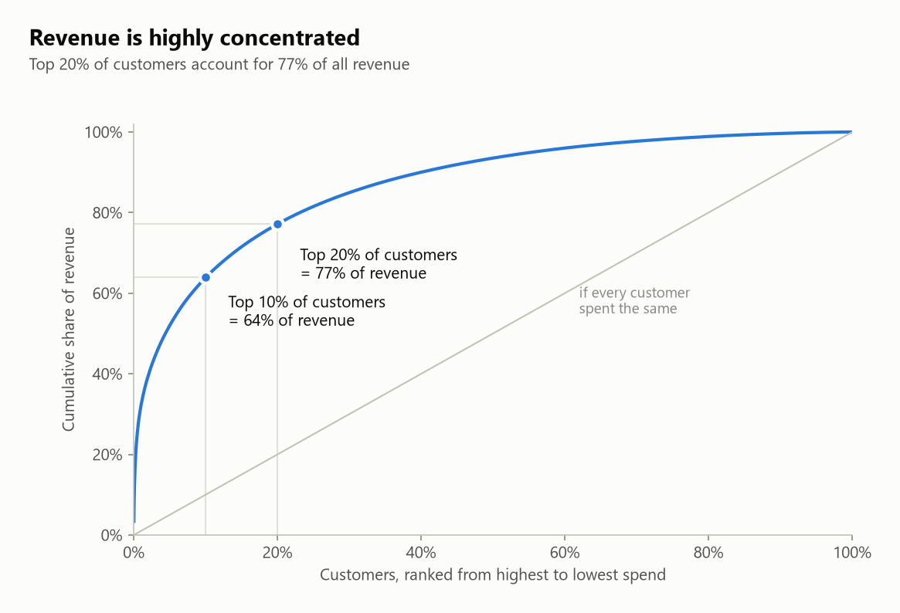
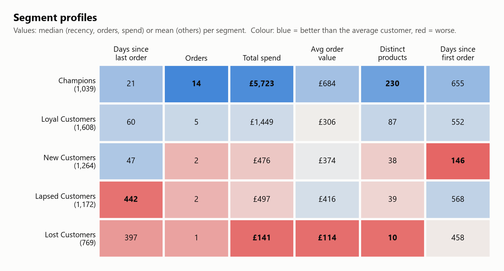
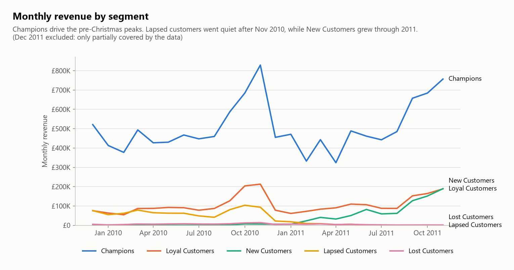
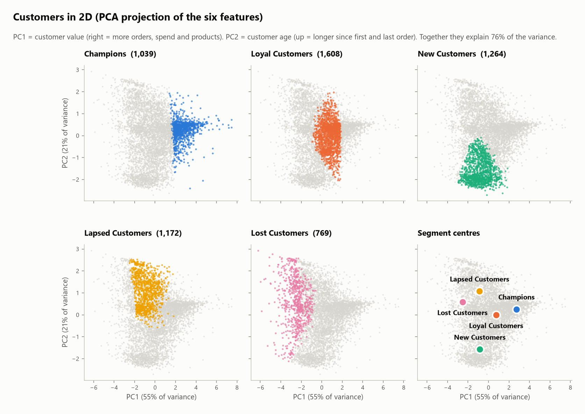
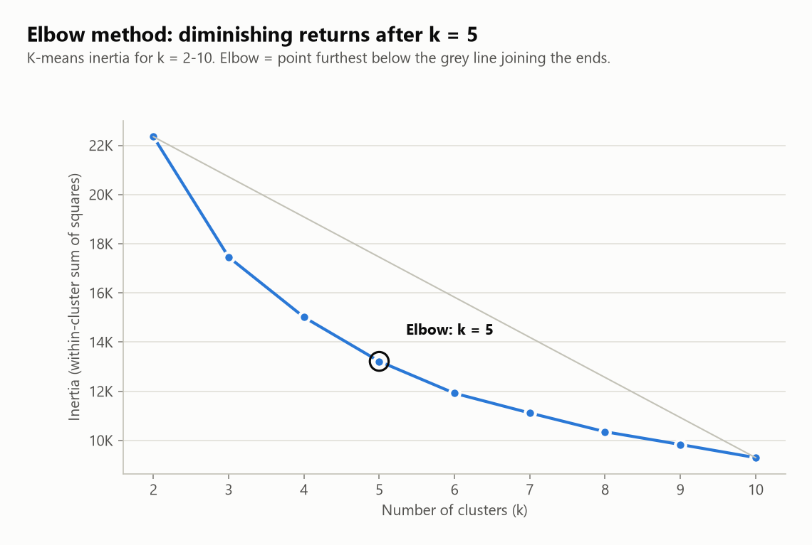
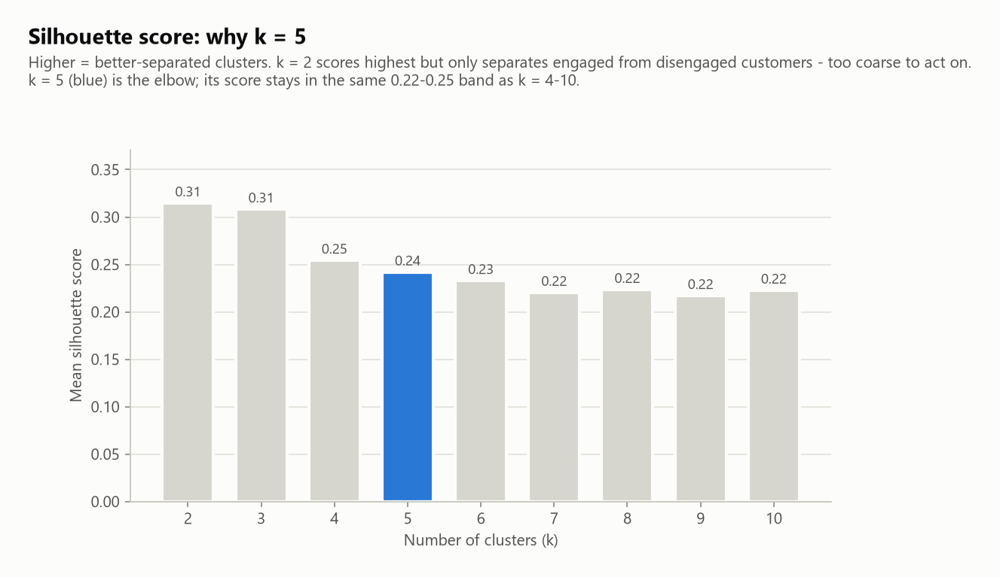
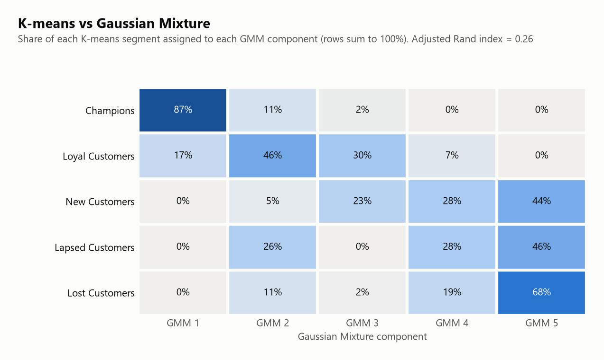

# Customer Segmentation for an Online Retailer

**Which customers drive the business, which are slipping away, and what should marketing do about each group?**

This project groups the 5,852 customers of a UK online gift retailer into five behavioural segments, using two years of real transaction data (£17.1M of sales). It profiles each segment and turns it into a specific marketing action. One command reproduces everything, from raw data download to charts.



---

## The business question

The retailer sends the same marketing to every customer. Management wants to know:

1. Are some customers far more valuable than others?
2. Which customers are drifting away and could still be won back?
3. What should each group be offered, and where should the budget go?

## Results at a glance

| Segment | Customers | % of customers | % of revenue | Typical customer* | What to do |
|---|---:|---:|---:|---|---|
| **Champions** | 1,039 | 17.8% | **73.5%** | last order 21 days ago, 14 orders, £5,723 spent | Protect with VIP treatment; no blanket discounts |
| **Loyal Customers** | 1,608 | 27.5% | 15.1% | last order 60 days ago, 5 orders, £1,449 spent | Cross-sell and volume tiers to grow them into Champions |
| **New Customers** | 1,264 | 21.6% | 5.4% | last order 47 days ago, 2 orders, £476 spent | Welcome journey focused on winning the next order |
| **Lapsed Customers** | 1,172 | 20.0% | 5.3% | last order 442 days ago, 2 orders, £497 spent | One targeted win-back campaign, then suppress |
| **Lost Customers** | 769 | 13.1% | 0.8% | last order 397 days ago, 1 order, £141 spent | Low-cost seasonal email only |

\*Median values per segment, as of 10 Dec 2011 (the day after the last transaction). Full figures: [`reports/segment_summary.csv`](reports/segment_summary.csv).

## Key findings

1. **A small group carries the business.** Champions are 17.8% of customers but produce **73.5% of revenue (£12.5M of £17.1M)**. Across all customers, the **top 20% generate 77% of revenue** and the **top 1% alone generate 32%**. Losing a handful of these accounts would hurt more than losing the bottom half of the customer list.
2. **Champions are active and broad buyers.** 87% of them ordered in the last 90 days. On average they bought 230 different products, with an average order of £684, more than twice the £306 of Loyal Customers.
3. **New customers are a real growth engine.** Monthly revenue from New Customers rose from about £5K in January 2011 to **£190K in November 2011**, matching the Loyal segment (£189K) that month. But **44% of them have ordered only once**, so the second order is the critical moment.
4. **Lapsed customers had bigger baskets than Loyal ones.** Their average order was **£416 vs £306 for Loyal Customers**, and together they spent £0.9M. Yet 88% have not bought in over a year, and they generated £0 in November 2011. They are worth one serious win-back attempt.
5. **Lost customers are low value.** The typical Lost customer placed a single order worth £141 in total (68% never ordered again). The segment contributes 0.8% of revenue, so expensive reactivation would not pay back.

## Recommended marketing actions

| Segment | Recommendation | Success metric |
|---|---|---|
| **Champions** (1,039) | **Protect and grow.** Create a VIP tier with early access to new and seasonal ranges, and give the top ~100 accounts a named account manager. Add referral rewards (wholesale buyers often know other shops). **Avoid blanket discounts**: these customers already buy at full price, so a discount mostly gives away margin. | Retention rate, revenue per Champion |
| **Loyal Customers** (1,608) | **Upgrade to Champions.** Send personalised "customers who bought X also bought Y" recommendations, since they buy 87 distinct products vs 230 for Champions. Offer volume-tier pricing and a points scheme that rewards order frequency. | Orders per customer, number moving into Champions |
| **New Customers** (1,264) | **Win the second order.** Run a 3-email welcome series featuring best-sellers, with a time-limited incentive on a second purchase within 30 to 60 days. Time the pre-Christmas campaign early, because these customers drove the late-2011 growth. | Second-order rate within 60 days |
| **Lapsed Customers** (1,172) | **One targeted win-back.** Send a "we've missed you" email with the new catalogue and one strong, single-use offer, plus a short survey on why they stopped. If 10% return with one average-size order (£416), that is about **£49K** of recovered revenue. Suppress after 2 to 3 unanswered contacts. | Reactivation rate, cost per reactivated customer |
| **Lost Customers** (769) | **Low-cost reactivation only.** Include them in the seasonal (pre-Christmas) newsletter, with no paid advertising. Remove them from active lists if they stay unengaged, which also improves email deliverability. | Cost per contact, unsubscribe/bounce rate |

## Charts

| | |
|---|---|
|  |  |
| **Revenue concentration.** Top 20% of customers = 77% of revenue. | **Segment profiles.** Blue = better than the average customer, red = worse. |
|  |  |
| **Monthly revenue by segment.** Champions drive the pre-Christmas peaks; New Customers grow through 2011. | **Customers in 2D (PCA).** Segments occupy distinct regions of the customer space. |

---

## The data

[Online Retail II](https://archive.ics.uci.edu/dataset/502/online+retail+ii) from the UCI Machine Learning Repository. It holds every transaction of a UK-based, non-store online retailer of giftware (many customers are wholesalers) between 1 Dec 2009 and 9 Dec 2011: **1,067,371 invoice lines**.

| Column | Meaning |
|---|---|
| `Invoice` | Invoice number; a leading `C` marks a cancellation |
| `StockCode`, `Description` | Product code and name |
| `Quantity`, `Price` | Units and unit price (£) |
| `InvoiceDate` | Date and time of the transaction |
| `Customer ID` | Customer identifier (missing for some rows) |
| `Country` | Customer's country |

The raw data is **not committed** to this repository (`data/raw/` is git-ignored). `python run_pipeline.py` downloads it automatically (45 MB). To download it manually, get the zip from the UCI page above, place `online_retail_II.xlsx` in `data/raw/`, and run `python -m src.download_data`.

## How to run

Requires Python 3.10+.

```bash
git clone <this-repo-url>
cd customer-segmentation
python -m venv .venv
.venv\Scripts\activate          # Windows  (macOS/Linux: source .venv/bin/activate)
pip install -r requirements.txt
python run_pipeline.py
```

The first run downloads the data and converts the Excel file to CSV, which takes about 2 minutes. After that, the full pipeline runs in about 20 seconds. All random seeds are fixed (`RANDOM_SEED = 42`), so results are identical on every run.

**Outputs**

| File | Contents |
|---|---|
| [`reports/segment_summary.csv`](reports/segment_summary.csv) | One row per segment: size, % customers, % revenue, average and median RFM, recommended action |
| `data/processed/customer_segments.csv` | Customer ID → segment, with each customer's features |
| [`reports/metrics.json`](reports/metrics.json) | Data volumes, k-selection curves, clustering quality, GMM comparison, revenue concentration |
| [`reports/cleaning_log.md`](reports/cleaning_log.md) | Every cleaning step with row counts and reasoning |
| [`reports/figures/`](reports/figures/) | All charts |

---

## Methodology (technical detail)

### 1. Data cleaning: [`src/clean.py`](src/clean.py)

Every step is logged with row counts in [`reports/cleaning_log.md`](reports/cleaning_log.md):

| Step | Rows removed | Reason |
|---|---:|---|
| Missing Customer ID | 243,007 | Cannot be attributed to a customer |
| Exact duplicates | 26,479 | Export duplicates, including the overlap between the two Excel sheets |
| Cancellation invoices (`C…`) | 18,390 | Returns are not purchases (7,901 invoices from 2,572 customers, £1.08M) |
| Non-positive quantity | 0 | Safety check; all were already removed with cancellations |
| Zero/negative price | 70 | Free samples and adjustments |
| Non-product stock codes | 2,846 | `POST`, `M` (manual), `C2` (carriage), `ADJUST`, `BANK CHARGES`, `DOT`, `D` (discount), test codes |

The result is **776,579 clean lines** (72.8% of raw), covering 5,852 customers, 36,594 invoices and 4,620 products. A `Revenue = Quantity × Price` column is added.

**Validation checks fail loudly** (`DataValidationError`) if an assumption breaks. They cover the expected columns and row count, no missing IDs, no cancellations, strictly positive quantities and prices, no duplicates, product codes only, dates within range, revenue arithmetic, and one customer per invoice.

### 2. Feature engineering: [`src/features.py`](src/features.py)

| Feature | Definition |
|---|---|
| Recency | Days since last purchase (snapshot = 10 Dec 2011) |
| Frequency | Number of distinct invoices |
| Monetary | Total revenue (£) |
| AvgOrderValue | Monetary ÷ Frequency |
| DistinctProducts | Number of different stock codes bought |
| TenureDays | Days since first purchase |

Features with |skewness| > 1 are `log1p`-transformed: Frequency (skew 12.0 → 1.0), Monetary (25.3 → 0.3), AvgOrderValue (53.4 → 0.1) and DistinctProducts (6.2 → −0.3). All six are then standardised with `StandardScaler`, so that no single feature dominates the distance metric.

### 3. Choosing the number of segments: [`src/segment.py`](src/segment.py)

| Elbow method | Silhouette score |
|---|---|
|  |  |

K-means (`n_init=20`) was fitted for k = 2–10.

- **Elbow:** detected automatically as the point furthest below the line joining the two ends of the inertia curve. That point is **k = 5**.
- **Silhouette:** the score is highest at k = 2 (0.315), but that solution only separates engaged from disengaged customers, which is too coarse to act on. At k = 5 the silhouette is **0.242**, in the same 0.22–0.25 band as every k from 4 to 10. Splitting further adds segments without making them more distinct.

**k = 5 was chosen.** It is also **stable**: refitting with 5 different random seeds gives an adjusted Rand index of at least 0.968 against the final model.

### 4. Comparison with a Gaussian Mixture Model



| Metric | K-means (k = 5) | Gaussian Mixture (5 components, full covariance) |
|---|---:|---:|
| Silhouette (higher is better) | **0.242** | 0.085 |
| Davies–Bouldin (lower is better) | **1.257** | 2.604 |
| Calinski–Harabasz (higher is better) | **2,421.8** | 1,163.5 |
| Agreement with K-means (adjusted Rand index) | – | 0.26 |

The GMM recovers the Champions almost exactly: **87% of Champions fall into a single GMM component**. It splits the remaining customers differently, because its flexible covariance shapes follow density rather than distance. K-means scores better on all three separation metrics and produces groups that map cleanly to marketing actions, so it is used for the final segmentation.

### 5. Naming the segments

K-means cluster numbers are arbitrary, so each cluster centre is matched to a business archetype (Champions, Loyal, New, Lapsed, Lost, and two others not used here) by comparing its standardised recency, frequency, monetary value and tenure with an archetype profile. The matching is a one-to-one assignment (Hungarian algorithm). Names are therefore reproducible and never assigned by hand.

### Limitations

- **Revenue is not profit.** There is no cost or margin data, so "value" means revenue.
- **Unidentified customers are excluded.** 23% of raw lines have no Customer ID and cannot be segmented.
- **Cancellations are excluded, not netted.** Most cannot be matched one-to-one with their original order.
- **The segments are a snapshot as of December 2011.** In production they should be refreshed monthly, with movement between segments tracked.
- **The customer base mixes wholesalers and consumers.** A B2B/B2C flag, if available, would sharpen the segments.

## Project structure

```
├── run_pipeline.py            # one command: download → clean → features → cluster → charts
├── requirements.txt
├── src/
│   ├── config.py              # paths, random seed, k range
│   ├── download_data.py       # resumable download from UCI + Excel → CSV
│   ├── clean.py               # cleaning steps, cleaning log, validation checks
│   ├── features.py            # RFM + extra features, log transform, scaling
│   ├── segment.py             # k selection, K-means, GMM comparison, naming, summary
│   └── visualize.py           # all charts (consistent colour per segment)
├── data/
│   ├── raw/                   # downloaded data (git-ignored)
│   └── processed/             # customer_features.csv, customer_segments.csv
└── reports/
    ├── segment_summary.csv
    ├── metrics.json
    ├── cleaning_log.md
    └── figures/               # 8 charts
```

## Tools used

Python · pandas · NumPy · scikit-learn (K-means, Gaussian Mixture, PCA, silhouette / Davies–Bouldin / Calinski–Harabasz) · SciPy (Hungarian assignment) · Matplotlib · requests
